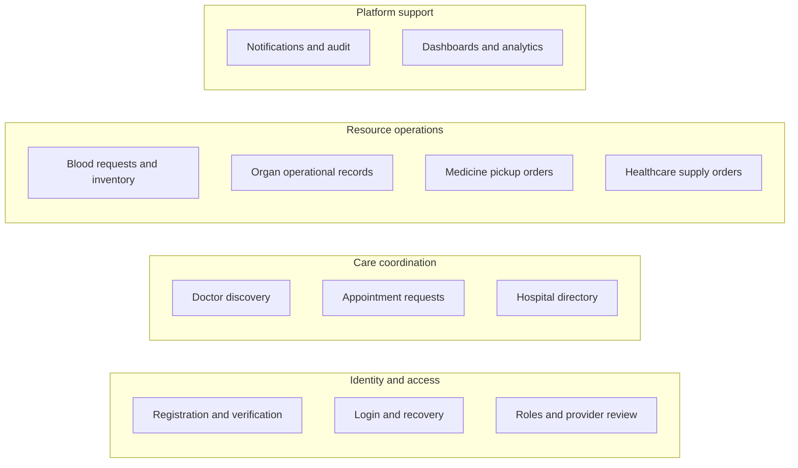
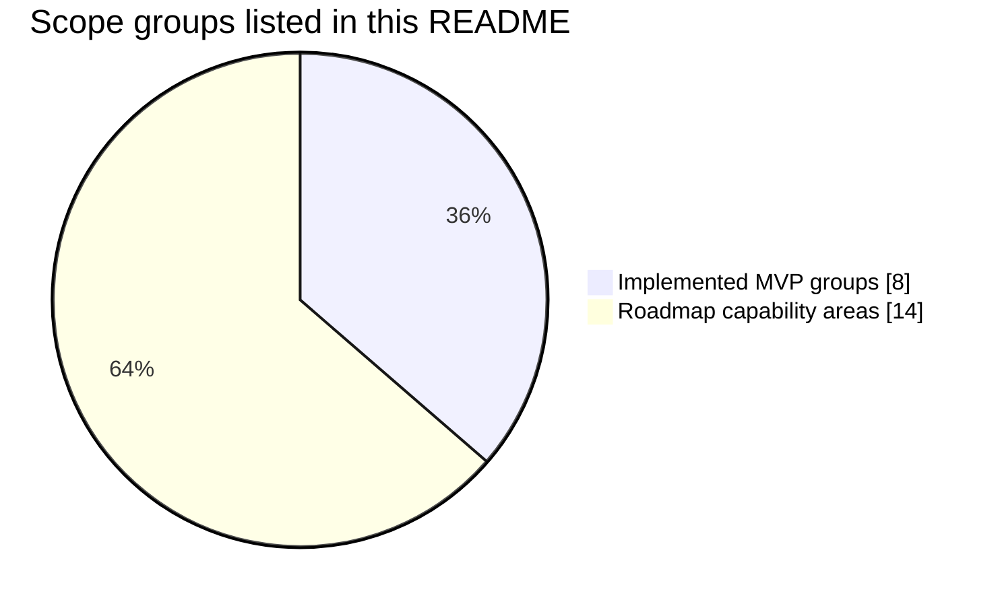
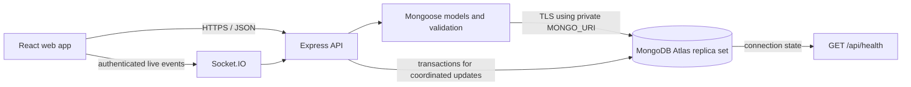
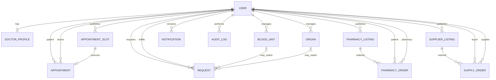
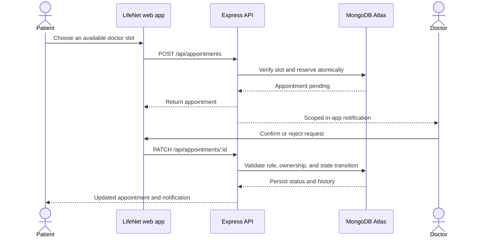
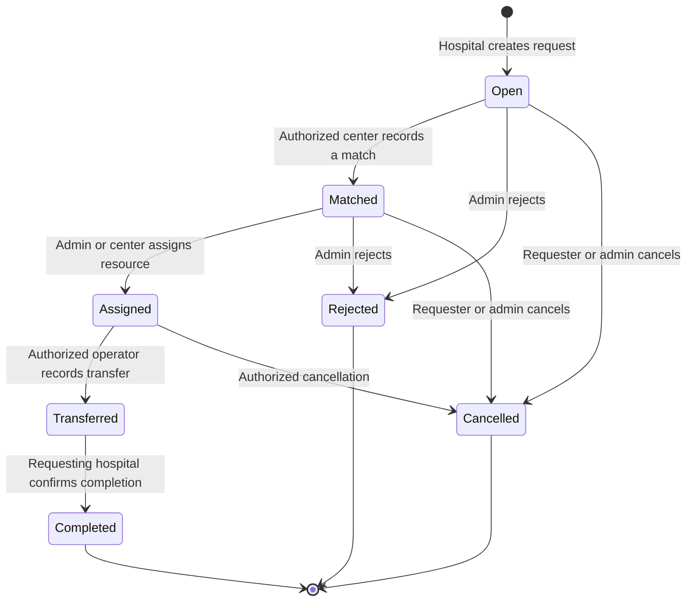

# LifeNet

**LifeNet is a role-based healthcare coordination platform.** It brings patients, clinicians, care organizations, blood banks, pharmacies, suppliers, procurement centers, and platform administrators into shared workflows for service discovery, appointment requests, reported inventory, and order coordination.

This repository contains a working MVP and its deployment configuration. It is not a clinical system: LifeNet does not diagnose, prescribe, determine donor eligibility, decide clinical suitability, allocate organs, or guarantee that inventory is currently available. Facilities and qualified professionals must confirm information and make clinical decisions.

## Product status

| Area | Current implementation |
| --- | --- |
| Accounts and access | Email verification, sign-in, password recovery, profile and password updates, role-based access, and admin review of provider applications |
| Doctor appointments | Approved doctors publish profiles and in-person appointment slots; patients request slots; doctors confirm or reject; allowed users can cancel |
| Hospital discovery | Signed-in users can search the approved hospital directory by organization/name and location |
| Blood coordination | Blood banks manage reported inventory; hospitals create requests; authorized centers review and reserve stock; status history tracks fulfillment |
| Organ coordination | Procurement centers manage operational records; organizations can review a shortlist and follow a request workflow. This is not a donor-recipient allocation system |
| Pharmacy | Pharmacies list medicine details and pickup availability; patients place pickup requests; pharmacies update order status; listings show stock-check time and flag reports older than 24 hours |
| Supplier orders | Suppliers list healthcare supplies; eligible organizations request stock; suppliers process orders |
| Operations | Recipient-scoped in-app notifications, audit records for selected workflows, role-aware dashboards, and admin analytics |
| Interface | Responsive React application with role-specific navigation, account screens, dashboard pages, and operational workflows |

### Capability map

The chart below groups the capabilities currently described in this README. It is a product-scope map, not a completion or quality score.



#### Scope snapshot

This chart counts the eight groups in the implementation table against the 14 capability areas listed in the roadmap. It is a count of listed scope items, not a project-completion percentage or an estimate of effort.



### In the project brief, not yet implemented

The brief describes a wider platform than this MVP. The following capabilities need separate implementation and review before they can be offered: telehealth/video consultations; digital prescriptions; patient health records and document storage; laboratory discovery, booking, and results; insurance workflows; hospital discovery beyond the current provider/admin directory; donor-interest registration and donation-camp management; SMS reminders; reviews and support tickets; maps and directions; multilingual content; and AI-assisted navigation. The current medicine workflow supports participating listings and pickup orders; it does not recommend substitutions or establish therapeutic equivalence. Online payments are not implemented.

## Roles

The API enforces permissions on the server. Hiding a screen in the interface is not an authorization control.

| Role | Main workflows |
| --- | --- |
| Patient | Search participating doctors, request appointments, review medicine listings, place pickup requests, manage account, and receive notifications |
| Doctor | Publish an approved professional profile, set appointment availability, and manage assigned appointments |
| Hospital | Review reported blood availability, create and follow requests, and request healthcare supplies |
| Blood bank | Maintain reported blood inventory and respond to blood requests |
| Procurement center | Maintain operational organ records and respond to organ requests |
| Pharmacy | Maintain medicine listings and process pickup requests; may also order supplies |
| Supplier | Maintain healthcare-supply listings and process organization orders |
| Administrator | Review provider applications, view operational analytics, and access administrative workflows |

Provider approval is an in-app review of submitted information. LifeNet does not independently verify professional licenses or business registrations.

## Architecture

- **Web client:** React, React Router, Vite, Tailwind CSS, and Recharts.
- **API:** Node.js, Express, Mongoose, and Zod validation.
- **Data store:** MongoDB. Multi-record coordination workflows use MongoDB transactions, so connect to a transaction-capable replica set. A hosted MongoDB Atlas deployment is the recommended setup.
- **Authentication:** short-lived access tokens and an HTTP-only refresh-token cookie; passwords are hashed. New accounts verify their email before signing in.
- **Live updates:** Socket.IO authenticates connections and sends recipient-scoped notifications and limited role-level operational events.
- **Hosting:** Render Blueprint and Docker image configuration are included. The app can serve the built client and API from one origin.

### Application and database flow



The browser never connects directly to MongoDB. Keep the connection string in the API environment only. Multi-record workflows require an Atlas deployment that supports replica-set transactions.

### Core data relationships



The diagram shows the main Mongoose references, not every field or validation rule. `Request` can refer to either a blood unit or an organ through a polymorphic resource reference. Appointment slots are uniquely reserved; order and request status changes retain history where implemented.

### Appointment request lifecycle



### Resource request lifecycle



Transitions are enforced by API permissions and workflow validation; they do not represent a clinical decision or verify the physical availability of a resource.

### Data ownership and sensitivity map

| Data group | Main records | Typical owner/access boundary | Notes |
| --- | --- | --- | --- |
| Identity | User, verification/reset token hashes | Account owner; administrators for review | Passwords are hashed; raw email tokens are not stored |
| Appointments | Doctor profile, appointment slot, appointment | Patient, assigned doctor, administrator | Slot reservation prevents overlapping booking |
| Blood coordination | Blood unit, request | Blood bank, requesting hospital, authorized operators | Inventory reports require facility confirmation |
| Organ operations | Organ record, request | Procurement center, requesting organization, authorized operators | No donor matching or allocation decision is performed |
| Pharmacy | Listing, pickup order | Pharmacy and patient on the order | Stock has a freshness indicator; no therapeutic advice |
| Supplier operations | Supplier listing, supply order | Supplier and purchasing organization | Operational order status and history |
| Platform operations | Notification, audit log | Recipient or administrator according to route | Notifications are recipient-scoped |

The exact model fields are defined in `server/models/`; this table summarizes access intent and product boundaries, not a data-protection certification.

## Get started

### 1. Create a hosted MongoDB database

Use the [MongoDB Atlas setup guide](docs/ATLAS_SETUP.md) for the exact console steps. The Atlas organization currently shows no projects, so create a project before creating a database deployment. LifeNet uses MongoDB transactions; use a transaction-capable Atlas deployment.

The required sequence is:

1. Create an Atlas project and database deployment for LifeNet.
2. Create a dedicated database user for this application. Use a unique password and grant only the access needed by the application database.
3. In Network Access, allow your development machine’s current IP address. For a hosted deployment, allow the hosting service’s documented outbound addresses or use an appropriate private network. Avoid opening database access to every IP address for production.
4. Choose **Connect → Drivers** and copy the MongoDB connection string. Set the database name to `lifenet` and replace the password placeholder. URL-encode special characters in the database password.
5. Keep the connection string private. Do not paste it into source files, screenshots, issues, or commits.

The URI belongs in the server's private environment as `MONGO_URI`. Its shape is:

```text
mongodb+srv://<database-user>:<URL-encoded-password>@<atlas-host>/lifenet?retryWrites=true&w=majority
```

This is a redacted format example. Never replace the placeholders in this README with real credentials. Use `server/.env` for local development and the hosting provider's private environment settings for deployment.

### 2. Configure the API

Requirements: Node.js 22.12 or later (or 20.19+) and npm.

```powershell
Copy-Item server/.env.example server/.env
```

Edit `server/.env` and set:

- `MONGO_URI` to the connection string from your database provider.
- `JWT_ACCESS_SECRET` and `JWT_REFRESH_SECRET` to different, randomly generated secrets. Each must be at least 32 characters in production.
- `CLIENT_URL` to the local client/API origins shown in the example for development.
- For Brevo email, set `EMAIL_PROVIDER=brevo`, `BREVO_API_KEY`, and `SMTP_FROM` to a verified sender. Local development can use SMTP or log action links when an email provider is not configured.

The `.env` file is ignored by Git. Never commit it or put database credentials in `client/.env`.

### 3. Install dependencies and start the app

In one terminal:

```powershell
cd server
npm ci
npm run dev
```

In a second terminal:

```powershell
cd client
npm ci
npm run dev
```

Open [http://localhost:5173](http://localhost:5173). The API readiness endpoint is [http://localhost:5000/api/health](http://localhost:5000/api/health); it returns success only after the API connects to MongoDB.

### 4. Create the first administrator

The public registration flow cannot create administrators. Once the API environment is configured, run this once from a secure workstation or hosting shell before inviting users:

```powershell
cd server
$env:BOOTSTRAP_ADMIN_EMAIL = 'admin@example.com'
$env:BOOTSTRAP_ADMIN_PASSWORD = 'use-a-unique-password-of-at-least-16-characters'
npm run admin:create
Remove-Item Env:BOOTSTRAP_ADMIN_EMAIL
Remove-Item Env:BOOTSTRAP_ADMIN_PASSWORD
```

Use your own unique address and password. The command checks production configuration, only creates an administrator when no active administrator exists, and requires a password of at least 16 characters. For a hosted first-admin setup, use the hosting provider’s one-off command or a secure administrative shell, then remove the bootstrap variables.

## Demo data

`npm run seed` creates synthetic users, inventory, and listings. It refuses to run when `NODE_ENV=production`. Run it only against a disposable database dedicated to demos; never seed a database that contains real user or operational data.

| Role | Demo email | Demo password |
| --- | --- | --- |
| Administrator | `admin@demo.lifenet.test` | `local-admin-demo` |
| Patient | `patient@demo.lifenet.test` | `local-patient-demo` |
| Doctor | `doctor@demo.lifenet.test` | `local-doctor-demo` |
| Hospital | `hospital@demo.lifenet.test` | `local-hospital-demo` |
| Pharmacy | `pharmacy@demo.lifenet.test` | `local-pharmacy-demo` |
| Supplier | `supplier@demo.lifenet.test` | `local-supplier-demo` |
| Blood bank | `bloodbank@demo.lifenet.test` | `local-bloodbank-demo` |
| Procurement center | `procurement@demo.lifenet.test` | `local-procurement-demo` |

These fixed credentials are for local demonstration only. Do not use them on a public deployment.

## Configuration reference

| Variable | Required | Purpose |
| --- | --- | --- |
| `NODE_ENV` | Production | Set to `production` when hosted |
| `PORT` | No | API port; defaults to `5000` |
| `MONGO_URI` | Yes | Private MongoDB connection string for the `lifenet` database |
| `JWT_ACCESS_SECRET` | Production | Unique signing secret, at least 32 characters |
| `JWT_REFRESH_SECRET` | Production | Different signing secret, at least 32 characters |
| `JWT_ACCESS_EXPIRY` | No | Access-token lifetime; defaults to `15m` |
| `JWT_REFRESH_EXPIRY` | No | Refresh-token lifetime; defaults to `7d` |
| `CLIENT_URL` | Split-origin only | Comma-separated allowed browser origins; same-origin deployment can omit it |
| `TRUST_PROXY` | Proxy deployments | Number of trusted proxy hops; leave `false` for direct connections |
| `EMAIL_PROVIDER` | Email enabled | Set to `brevo` to use the HTTPS transactional email API; otherwise the app uses SMTP |
| `BREVO_API_KEY` | Brevo email | Private Brevo API key; never put it in the client bundle |
| `SMTP_HOST`, `SMTP_PORT`, `SMTP_SECURE` | SMTP only | SMTP server settings; free Render services block SMTP ports |
| `SMTP_USER`, `SMTP_PASSWORD` | SMTP only | Private SMTP credentials |
| `SMTP_FROM` | Email enabled | Verified sender address/name for LifeNet messages |
| `VITE_API_URL`, `VITE_SOCKET_URL` | Split-origin dev only | Client API and Socket.IO origins; omit for same-origin production |

Never put secrets in variables prefixed with `VITE_`: Vite embeds them into browser assets.

## Deployment

### Render

The repository includes [`render.yaml`](render.yaml) on Render's free compute plan for a public preview. Render free web services can spin down after inactivity and Render does not recommend them for production; use a paid compute plan before relying on the service for public production traffic. In Render, create a Blueprint from this GitHub repository and supply the environment values marked as manual:

1. `MONGO_URI`: the private MongoDB Atlas connection string. Allow the Render service's documented outbound ranges in Atlas; avoid `0.0.0.0/0`.
2. For Brevo email, set `EMAIL_PROVIDER=brevo`, `BREVO_API_KEY`, and `SMTP_FROM` to a verified sender. Render's free service cannot send SMTP on ports 25, 465, or 587.
3. Render generates separate access and refresh secrets. The Blueprint sets `TRUST_PROXY=1` for the platform proxy.
4. Confirm `/api/health` returns HTTP 200 with `success: true`, then create the first administrator through a secure one-off command and remove the temporary bootstrap variables.

Back up the database, restrict database network access, and confirm the email sender domain before inviting users. The health endpoint verifies API-to-database connectivity; it does not verify that email delivery or every user workflow is functioning.

### Optional app-only Docker Compose

Docker is optional. Compose runs the LifeNet app and a local Mailpit email catcher; it **does not run MongoDB**. Set `MONGO_URI` in `server/.env` to the hosted database connection string first. Mailpit captures messages at [http://localhost:8025](http://localhost:8025) and does not send them externally.

```powershell
Copy-Item server/.env.example server/.env
# Edit server/.env with your hosted MONGO_URI and unique secrets
docker compose up --build -d
```

To view captured emails, open Mailpit. This Compose setup is intended for local development and demonstration, not as a database backup or production deployment strategy.

## Quality checks

Run the checks from the repository root:

```powershell
npm test --prefix server
npm run lint --prefix client
npm run build --prefix client
```

The current server test suite covers selected authentication input and response-privacy rules. A successful client build, lint run, or API health response does not replace end-to-end workflow checks against a real test database and configured email service.

## Product boundaries and next roadmap

LifeNet currently coordinates operational listings and requests. Reported blood and organ data may become stale and must be confirmed by the relevant facility. Organ records are not donor profiles, and the platform does not determine compatibility or allocate organs. Medicines are catalogued by product attributes; only a qualified professional can advise whether a medicine is appropriate for a patient.

The next roadmap should first prove and harden the existing end-to-end flows: registration and provider approval; appointment booking and cancellation; pharmacy and supplier orders; inventory reservation, transfer, completion, and cancellation; notification delivery; and admin review. After those workflows are verified, expand the brief in deliberate phases:

1. Improve hospital/provider discovery, inventory freshness views, pharmacy price comparison, and user-facing support/contact information.
2. Add reminders and response tracking using a configured communications provider.
3. Design separate, privacy-reviewed modules for prescriptions, records, labs, and telehealth before storing clinical data or enabling remote consultations.
4. Consider payments, insurance, multilingual support, maps, reviews, or AI-assisted navigation only with the required providers, safeguards, and review.

Before use with real patient, donor, pharmacy, or provider data, complete a qualified security, privacy, regulatory, and operational review. This repository does not claim healthcare compliance certification.

## Documentation

- [API reference](docs/API.md) — endpoints, request roles, and access rules.
- [Client notes](client/README.md) — frontend development and split-origin setup.
- [Server notes](server/README.md) — API structure, data model map, environment configuration, and operational commands.

The original project brief is a planning document. This README marks which planned modules exist in the current MVP and which still need implementation. The repository does not include credentials or production data. Keep secrets in local ignored environment files or in the hosting provider’s secret manager.
