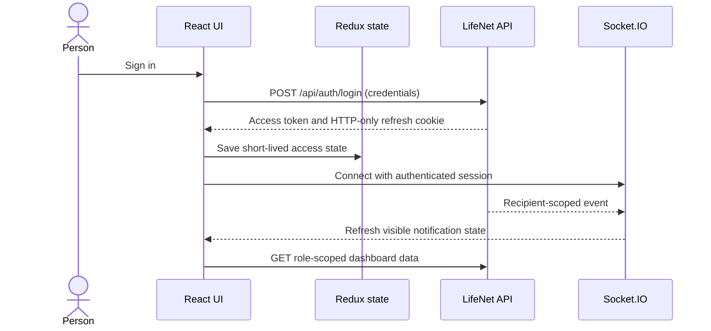

# LifeNet web client

LifeNet’s browser application is a React single-page app built with Vite. It provides role-specific experiences for patients, clinicians, hospitals, blood banks, pharmacies, suppliers, procurement centers, and administrators.

For product scope, role access, deployment, and safety boundaries, start with the [repository README](../README.md). The server API routes and role rules are summarized in [docs/API.md](../docs/API.md).

## Interface stack

| Concern | Implementation |
| --- | --- |
| UI framework | React |
| Routing | React Router |
| Styling | Tailwind CSS v4, shared CSS design tokens, and shadcn-style UI primitives |
| Data and charts | Redux Toolkit, API services, and Recharts |
| Live updates | Socket.IO client |
| Build tooling | Vite |

The shared palette is blue and white, with light/dark design tokens in `src/index.css`. Components should use shared tokens (`bg-background`, `text-foreground`, `border-border`, `text-primary`) before adding one-off colors. Use the app’s established UI components and icon set for consistent controls.

## Local development

Requirements: Node.js 22.12 or later (or 20.19+) and npm. Start the API first; see [server setup](../server/README.md).

```powershell
npm ci
npm run dev
```

Open [http://localhost:5173](http://localhost:5173). Vite proxies `/api` and `/socket.io` to `http://localhost:5000` during development. The database connection string belongs only in `server/.env`, never in this directory or a `VITE_` variable.

## Client configuration

For same-origin production hosting, leave these unset; the API and UI are served from one host. For a separate client/API deployment, use `client/.env.example` as a template:

| Variable | Purpose | Secret? |
| --- | --- | --- |
| `VITE_API_URL` | Base URL for the API | No |
| `VITE_SOCKET_URL` | Socket.IO server origin | No |

Vite embeds `VITE_` values in public browser assets. Never place credentials, tokens, private keys, or database URIs in them.

## Client request and session flow



Server-side authorization is authoritative. A hidden button or route is only a user-interface convenience, not an access control.

## Build output

```powershell
npm run build
```

Vite writes production assets to `client/dist`. The Docker image copies those assets into the API’s static directory so the client, API, and Socket.IO share one origin. The production page is at `/`; readiness is at `/api/health`.

## UX and accessibility checklist

| Area | UI expectation |
| --- | --- |
| Forms | Visible labels, inline validation, clear success/error feedback, and keyboard operation |
| Loading | Preserve layout and explain when data is loading or empty |
| Destructive actions | Identify the target and provide a clear cancel path |
| Color | Keep text readable in both themes; do not use color alone for status |
| Motion | Respect `prefers-reduced-motion` |
| Navigation | Role-aware links, clear current-page state, and responsive layouts |
| Health workflows | Clearly label reported inventory and direct users to confirm with the facility |

## Related docs

- [Product and deployment overview](../README.md)
- [Server/API setup](../server/README.md)
- [API route and access reference](../docs/API.md)
