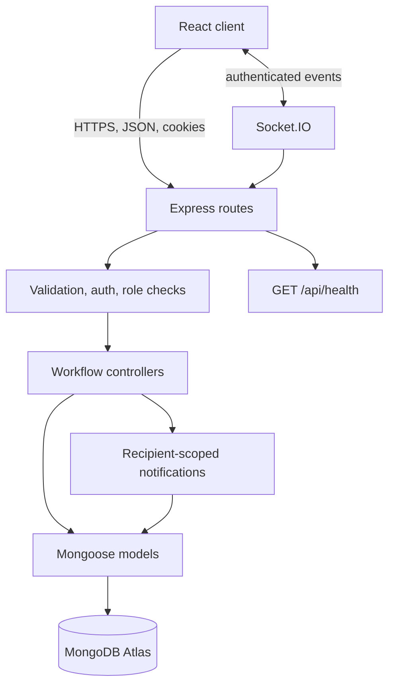
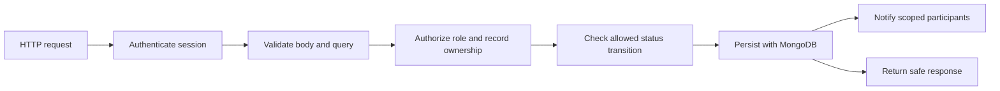

# LifeNet API and data service

The `server/` folder contains the Express API, MongoDB models, authentication and authorization middleware, operational workflows, and Socket.IO server. The web client is documented in [client/README.md](../client/README.md); product scope and setup are in the [root README](../README.md).

## Runtime architecture



## Data model index

| Model | Responsibility | Key relationships |
| --- | --- | --- |
| `User` | Identity, role, organization, verification, refresh session | Owner/actor for most operational records |
| `DoctorProfile` | Doctor details and approval state | One profile per doctor user |
| `AppointmentSlot` | Doctor availability and reservation state | Belongs to doctor; can be reserved by appointment |
| `Appointment` | Patient request and doctor response | Patient, doctor, and slot references |
| `BloodUnit` | Reported blood component inventory | Managed by a blood bank; may be referenced by a request |
| `Organ` | Operational organ record | Managed by procurement center; may be referenced by a request |
| `Request` | Hospital coordination workflow | Requester, assigned center, and optional blood/organ resource |
| `PharmacyListing` | Medicine product and pickup availability | Owned by a pharmacy |
| `PharmacyOrder` | Patient pickup request | Patient and pharmacy listing/owner |
| `SupplierListing` | Healthcare supply availability | Owned by a supplier |
| `SupplyOrder` | Organization purchase request | Buyer and supplier |
| `Notification` | In-app user notification | Recipient user |
| `AuditLog` | Selected action history | Actor user and action target |

These models support coordination software. They do not replace clinical records, eligibility decisions, prescriptions, or professional judgement.

## API and permissions

Base path: `/api`. See the [API reference](../docs/API.md) for the method-by-method route table.



The API enforces access rules at the server, validates request data, and scopes returned records to the current user and role. For coordinated multi-record operations, use an Atlas replica set that supports MongoDB transactions.

## Local setup

Requirements: Node.js 22.12 or later (or 20.19+) and npm. MongoDB is not bundled; point to an Atlas deployment or another transaction-capable replica set.

```powershell
Copy-Item .env.example .env
# Set MONGO_URI and distinct JWT_ACCESS_SECRET / JWT_REFRESH_SECRET in .env
npm ci
npm run dev
```

The API listens on port `5000` by default. Check database readiness at [http://localhost:5000/api/health](http://localhost:5000/api/health). A healthy response reports `success: true`; a missing database connection returns HTTP 503.

## Environment variables

| Variable | Use |
| --- | --- |
| `NODE_ENV` | Use `production` in hosted environments |
| `PORT` | Host-provided port; defaults to `5000` locally |
| `MONGO_URI` | Private connection string for database `lifenet` |
| `JWT_ACCESS_SECRET` | Random signing secret, 32+ characters in production |
| `JWT_REFRESH_SECRET` | Separate random signing secret, 32+ characters |
| `JWT_ACCESS_EXPIRY` | Access token lifetime; defaults to `15m` |
| `JWT_REFRESH_EXPIRY` | Refresh token lifetime; defaults to `7d` |
| `CLIENT_URL` | Allowed origins for split-origin hosting |
| `TRUST_PROXY` | Trusted proxy setting; use `1` behind Render |
| `EMAIL_PROVIDER` | Set to `brevo` to send through Brevo HTTPS API |
| `BREVO_API_KEY` | Private Brevo API key; keep in the host secret manager |
| `SMTP_FROM` | Verified email sender; required when email is enabled in production |
| `SMTP_HOST`, `SMTP_PORT`, `SMTP_SECURE` | SMTP fallback configuration; SMTP is blocked on Render free services |
| `SMTP_USER`, `SMTP_PASSWORD` | SMTP-only authentication settings |
| `BOOTSTRAP_ADMIN_EMAIL`, `BOOTSTRAP_ADMIN_PASSWORD` | One-time secure admin creation command only |

Never commit `.env` or put server credentials in client `VITE_` variables. On Render Free, use Brevo over HTTPS instead of SMTP.

## Operational commands

```powershell
npm run dev
npm test
npm run seed
npm run admin:create
```

`npm run seed` creates synthetic demo data and refuses to run in production. Use only on a disposable development database. `npm run admin:create` requires one-time environment variables and should be run in a secure environment; remove those bootstrap values immediately afterward.

## Failure triage

| Symptom | Check |
| --- | --- |
| Process exits at startup | `NODE_ENV`, URI, JWT secrets, required email settings, and Render logs |
| Health returns 503 | Atlas database status, DB user permissions, URI password encoding, and Atlas network access list |
| Browser requests fail | `CLIENT_URL`, cookies/credentials, browser network tab, and API logs |
| Emails are not delivered | Brevo API key, verified sender, `EMAIL_PROVIDER=brevo`, and provider account limits |
| User receives 403 | Account approval, role, record ownership, and allowed workflow state |

Do not respond to a database allowlist failure by opening Atlas to every internet address. Use the hosting provider’s documented outbound CIDRs or private networking.
